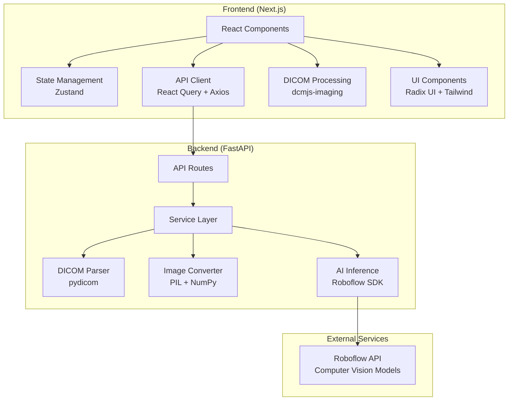

<div align="center">
  
</div>
<h1 align="center">
Dental X-Ray Analysis AI
</h1>
<p align="center">


</p>

_An AI-powered platform for detecting dental conditions in X-ray images using computer vision and DICOM processing_

[Features](#-features) • [Architecture](#-architecture) • [Setup](#-setup--installation) • [API Documentation](#api-documentation)

---

## [▶️ Demo Video](https://www.youtube.com/watch?v=diI3qsaASuo)

[](https://www.youtube.com/watch?v=diI3qsaASuo)

[YouTube Link](https://www.youtube.com/watch?v=diI3qsaASuo)

## 📋 Table of Contents

- [🌟 Introduction](#-introduction)
- [✨ Features](#-features)
- [🏗️ Architecture](#️-architecture)
- [🛠️ Tech Stack](#️-tech-stack)
- [📋 Prerequisites](#-prerequisites)
- [🚀 Setup & Installation](#-setup--installation)
- [🏃‍♂️ Running the Application](#️-running-the-application)
- [📚 API Documentation](#-api-documentation)
- [🐳 Docker Deployment](#-docker-deployment)
- [📁 Project Structure](#-project-structure)
- [⚙️ Environment Configuration](#️-environment-configuration)
- [🔧 Development](#-development)

## 🌟 Introduction

Dobbe is a modern web application that leverages artificial intelligence to analyze dental X-ray images and detect various dental conditions such as cavities and periapical lesions. The platform supports both standard image formats and DICOM files, providing comprehensive metadata extraction and analysis capabilities.

## ✨ Features

### 🔍 AI-Powered Detection

- **Cavity Detection**: Automatically identify cavities with confidence scores
- **Periapical Lesion Detection**: Detect periapical lesions with precise bounding boxes
- **Real-time Analysis**: Fast inference using Roboflow's computer vision models

### 📁 File Support

- **DICOM Processing**: Full DICOM file support with metadata extraction
- **PNG Image Support**: Upload PNG dental X-rays for AI detection; DICOM studies are converted to lossless PNG for model inference while original DICOM metadata is extracted and returned separately for display and reporting
- **DICOM Metadata**: Preserve and display available patient, study, acquisition, equipment, and image details independently of the converted model image
- **Drag & Drop Interface**: Intuitive file upload experience
- **File Validation**: DICOM and PNG type validation with a 10MB per-file limit
- **Sample Files**: Test DICOM files available in `docs/sample/` folder for development and testing

### 🏥 Clinical Workspace

- **Two-Screen Workflow**: Separate New Analysis uploads from the Analysis Workspace; completing processing opens the workspace directly
- **Responsive Navigation**: Full-height desktop sidebar and accessible slide-out navigation on smaller screens
- **Per-Study Review**: Switch between completed and failed studies in the analysis workspace
- **Responsive Radiology UI**: Clinical navy and teal styling keeps uploads, DICOM previews, and findings easy to review across screen sizes

### 📊 Comprehensive Results

- **Image Review**: Large radiograph viewer with zoom controls, fullscreen inspection, and numbered model regions
- **Linked Findings**: Selecting a numbered finding highlights its box; selecting a box identifies the matching finding
- **Duplicate Handling**: Near-identical overlapping predictions of the same model class are suppressed from the clinical view, while raw predictions remain in diagnostics
- **Model Diagnostics**: Confidence scores (model scores, not diagnostic probabilities) and raw bounding-box coordinates are hidden in a collapsible technical section
- **Metadata Display**: DICOM metadata remains available separately from the converted inference image
- **Clinical Review Workspace**: Detection summary, FDI odontogram, finding crops, linked radiograph viewer, overlay toggle, and class-specific clinical assessment matrix
- **Dentist Review Draft**: Findings can be confirmed, modified, assigned a dentist-identified FDI tooth, marked not applicable, and annotated with observations; review drafts save only in the current browser
- **Research Mode**: Optional Groq or Gemini vision analysis returns structured, multi-finding research hypotheses, differential considerations, investigations, and broad care-pathway categories for dentist discussion
- **Explicit External-Processing Consent**: Research Mode is opt-in per analysis; only the image, model detections, image dimensions/modality, and structured tooth/label annotations are sent to the configured provider, not DICOM metadata or free-text notes
- **Export Capabilities**: Print or download clinical review reports as PDFs

### 🩺 Clinical Review Aid

- **Finding-Specific Review Actions**: Supported labels, including restorations, root canal treatment, and impaction, receive refreshable clinician next steps tied to each submitted detection
- **Research Hypotheses**: Optional multimodal analysis considers the source radiograph, displayed and raw detections, and structured dentist-entered labels/tooth assignments; model predictions remain separate from LLM interpretations
- **Research Limitations**: AI hypotheses are not diagnoses or treatment instructions. Care pathways are restricted to broad evaluation categories; no prescriptions, procedural instructions, or inferred tooth numbers are generated
- **Literature Scope**: No external dental literature database is connected; the model must not invent citations, and the report discloses that literature was not retrieved
- **Validation Status**: Neither the configured prompts nor Groq research interpretations are validated clinical protocols; a dentist must independently review the image and patient context
- **Review Persistence**: Dentist-entered review drafts use browser local storage only; there is no authentication or server-side clinical record
- **External Processing**: The selected provider receives image pixels only after per-analysis user consent and confirmation that the image is authorized and de-identified/test data; DICOM metadata and free-text dentist notes are excluded, but text burned into image pixels cannot be automatically removed
- **Dentist Confirmation Required**: The impression draft is not saved or identity-verified and is not a final clinical record

### 📄 PDF Export Features

- **Professional Formatting**: Clean, medical-grade PDF layout with proper typography
- **Clinical Review Content**: Includes study information, summary, dentist-assigned FDI chart locations, annotated source-image copy, findings, assessment prompts, limitations, dentist-entered observations, review status, and final-impression draft
- **Technical Information**: DICOM metadata, image specifications, and processing details
- **Multi-page Support**: Automatic page breaks and pagination for lengthy reports
- **Draft Status**: Clearly labels browser-saved user-entered review as unauthenticated and not a final clinical record

## 🏗️ Architecture



### Architecture Highlights

- **Microservices Design**: Separate frontend and backend services
- **Type Safety**: Full TypeScript implementation with Pydantic models
- **Async Processing**: Non-blocking file processing and API calls
- **Error Handling**: Comprehensive error boundaries and validation
- **Scalable Structure**: Modular design for easy feature additions

## 🛠️ Tech Stack

### Frontend

- **Framework**: Next.js 15.3.3 with React 19
- **Language**: TypeScript
- **Styling**: Tailwind CSS v4 with customized shadcn/ui
- **State Management**: Zustand + React Query (TanStack Query)
- **UI Components**: shadcn/ui + Radix UI primitives
- **Medical Imaging**: dcmjs-imaging for DICOM preview (uses WASM for fast client side parsing)
- **File Handling**: React Dropzone

### Backend

- **Framework**: FastAPI with Python 3.12+
- **Medical Imaging**: pydicom for DICOM processing
- **Image Processing**: Pillow (PIL) + NumPy
- **AI Inference**: Roboflow Inference SDK
- **Validation**: Pydantic v2 with type safety
- **Configuration**: Pydantic Settings with environment variables
- **Package Management**: UV for fast dependency resolution

### External Services

- **AI Models**: [Roboflow computer vision platform](https://app.roboflow.com/ "Roboflow computer vision platform")
- **Model**: `p_fase_1_v2/4`
- **Model classes**: Determined by the selected Roboflow model

## 📋 Prerequisites

- **Node.js**: v18.0.0 or higher
- **Python**: 3.12 or higher
- **UV**: Python package manager ([installation guide](https://docs.astral.sh/uv/getting-started/installation/))
- **pnpm**: Fast package manager for Node.js (optional but recommended)
- **Roboflow API Key**: Required for AI inference

## 🚀 Setup & Installation

### 1. Clone the Repository

```bash
git clone https://github.com/adityanandanx/dental-conditions-detection
cd dental-conditions-detection
```

### 2. Backend Setup

```bash
cd backend

# Install dependencies using UV
uv sync

# Create environment file
cp .env.example .env
# Edit .env and add your Roboflow API key
```

### 3. Frontend Setup

```bash
cd ../frontend

# Install dependencies
pnpm install
# or
npm install

# Create environment file
cp .env.example .env.local
```

### 4. Environment Configuration

Create `.env` files in both directories:

**Backend (`backend/.env`)**:

```env
ROBOFLOW_API_KEY=your_roboflow_api_key_here
RESEARCH_PROVIDER=groq
GROQ_API_KEY=your_groq_api_key_here
GROQ_RESEARCH_MODEL=qwen/qwen3.8-27b
GOOGLE_API_KEY=your_rotated_google_api_key_here
GOOGLE_RESEARCH_MODEL=gemini-flash-latest
DEBUG=false
```

The backend requires a Roboflow API key for image inference. Research Mode is optional and requires a key for the selected provider (`RESEARCH_PROVIDER=groq` or `RESEARCH_PROVIDER=gemini`); without it, deterministic review guidance remains available. For Docker Compose, put keys in the repository-root `.env` file; for local backend development, put them in `backend/.env`. Never commit API keys, and do not send identifiable patient images to an external model.

**Frontend (`frontend/.env.local`)**:

```env
NEXT_PUBLIC_API_URL=http://localhost:8000/api/v1
```

## 🏃‍♂️ Running the Application

### Development Mode

**Terminal 1 - Backend**:

```bash
cd backend

# Unix/Linux/macOS
source .venv/bin/activate
# Windows
.venv\Scripts\activate

fastapi dev
```

**Terminal 2 - Frontend**:

```bash
cd frontend
pnpm dev
# or
npm run dev
```

### Production Mode

**Backend**:

```bash
cd backend

# Unix/Linux/macOS
source .venv/bin/activate
# Windows
.venv\Scripts\activate

fastapi run
```

**Frontend**:

```bash
cd frontend
pnpm build && pnpm start
# or
npm run build && npm start
```

### Access Points

- **Frontend**: http://localhost:3000
- **Backend API**: http://localhost:8000
- **API Documentation**: http://localhost:8000/docs
- **Alternative API Docs**: http://localhost:8000/redoc

## 📚 API Documentation

### Endpoints

#### `POST /api/v1/detect`

Detect dental conditions in standard image files.

**Request**: Multipart form with image file
**Response**: Detection results with bounding boxes and confidence scores

#### `POST /api/v1/detect-dicom`

Process DICOM files with metadata extraction or PNG images without DICOM metadata.

**Request**: Multipart form with a DICOM (`.dcm`, `.dicom`), DICOM-compatible RVG (`.rvg`), or PNG (`.png`) file. Proprietary RVG formats that are not DICOM-compatible are not supported.
**Response**: Complete analysis with the following format:

```json
{
  "predictions": [
    {
      "x": 346.5,
      "y": 323.5,
      "width": 107,
      "height": 105,
      "confidence": 0.839,
      "class": "cavity",
      "class_id": 0,
      "detection_id": "uuid-string"
    }
  ],
  "metadata": {
    "patient_id": "12345",
    "study_date": "20241208"
    // ... additional DICOM metadata; empty for PNG images
  },
  "image_info": {
    "original_shape": [512, 512],
    "converted_format": "PNG",
    "converted_size": [512, 512]
  }
}
```

#### `POST /api/v1/generate-diagnostic-report`

Generate deterministic clinician review prompts from detection results already returned by `/api/v1/detect-dicom`. This endpoint does not use an external language model.

**Request**: JSON with `predictions`, optional `metadata`, and optional `image_info`
**Features**:

- Does not rerun inference; uses the submitted detections from the completed analysis
- Produces uncertainty notes and one class-specific assessment prompt for each supplied detection ID
- Tailors review points to the detected label, including explicit handling of implant brands, anatomy labels, and unconfigured classes
- Does not infer tooth numbers, confirm diagnoses, prescribe treatment, or assign assistant tasks

**Response**: Clinical review aid in the following format:

```json
{
  "diagnostic_report": {
    "uncertainty_and_limitations": "These class-specific prompts are for clinician review, not diagnoses or treatment recommendations, and have not been independently validated as a clinical protocol. Model scores are not calibrated diagnostic probabilities. A dentist must review the source radiograph and clinical context before documenting a conclusion.",
    "suggested_assessments": [
      {
        "detection_id": "uuid-string",
        "suggestion": "Finding 01 (cavity): Inspect the marked surface for a radiolucency and its apparent relationship to enamel, dentin, and the pulp; check for proximal overlap, cervical burnout, and restoration-related artifacts. Correlate with a clinical visual examination, symptoms, and caries risk. The image and model label alone cannot establish lesion activity, cavitation, or treatment need."
      }
    ],
    "generated_at": "2024-12-08T10:30:00Z"
  },
  "detections_used": [
    {
      "x": 346.5,
      "y": 323.5,
      "width": 107,
      "height": 105,
      "confidence": 0.839,
      "class": "cavity",
      "class_id": 0,
      "detection_id": "uuid-string"
    }
  ],
  "metadata": {
    "patient_id": "12345",
    "study_date": "20241208"
    // ... additional DICOM metadata (if DICOM file)
  }
}
```

#### `GET /api/v1/research-mode`

Returns whether the optional Groq- or Gemini-powered Research Mode is configured and the selected model. It does not expose the API key.

#### `POST /api/v1/research-analysis`

Generate exploratory, structured research hypotheses from a de-identified/test image and its actual model outputs using the provider selected by `RESEARCH_PROVIDER`. The request must contain `share_consent: true`; the UI requires a per-analysis confirmation before sending.

**External data**: The selected provider receives the image pixels, displayed and raw detections, image dimensions/modality, and structured dentist-entered labels/tooth assignments. DICOM metadata and free-text dentist notes are excluded. Burned-in identifiers in image pixels cannot be automatically removed.

**Request**: JSON containing `predictions`, `raw_predictions`, `image_info`, optional `modality`, base64 `image_data_url` (PNG/JPEG), `dentist_annotations`, and `share_consent`.

**Response**: `analysis` contains a separate LLM interpretation for each detection, differentials with supporting and missing evidence, investigations, broad care-pathway categories, follow-up, cross-finding patterns, and a combined interpretation. `model_predictions` preserves the original model detections separately. Model confidence values are copied from inference, not generated by the LLM.

```json
{
  "analysis": {
    "research_mode": "research",
    "model": "qwen/qwen3.8-27b",
    "generated_at": "2026-10-31T00:00:00",
    "findings": [
      {
        "detection_id": "uuid-string",
        "finding_name": "cavity",
        "model_confidence": 0.839,
        "anatomical_location": "Tooth not identified",
        "possible_diagnosis": "Unconfirmed radiographic hypothesis",
        "differential_diagnoses": [
          {
            "diagnosis": "Example differential",
            "supporting_evidence": "Image evidence to verify",
            "evidence_against_or_missing": "Clinical examination not provided"
          }
        ],
        "ai_interpretation": "Exploratory interpretation requiring image and clinical review",
        "clinical_significance": "Potential significance if confirmed",
        "recommended_investigations": ["Clinical examination for dentist consideration"],
        "potential_treatment_options": ["restorative assessment"],
        "follow_up": "Determine based on confirmed findings and patient context",
        "evidence_and_limitations": ["Model label is not a diagnosis"],
        "related_detection_ids": [],
        "dentist_annotation_comparison": "No dentist annotation provided"
      }
    ],
    "combined_clinical_interpretation": "Unconfirmed research summary",
    "cross_finding_patterns": [],
    "source_scope": "No external dental literature was retrieved; no citations are provided.",
    "limitations": "Exploratory AI-generated research hypotheses only."
  },
  "model_predictions": []
}
```

Research output is not clinically validated, must not be used by itself for care decisions, and does not provide prescriptions or procedural instructions. No literature database is connected; the model is instructed not to invent citations.

#### `GET /api/v1/health`

Health check endpoint for monitoring.

## 🐳 Docker Deployment

### Quick Start

```bash
# Create the environment file and add your API keys
echo "ROBOFLOW_API_KEY=your_api_key_here" > .env
# Optional: enable consent-based Groq Research Mode
echo "GROQ_API_KEY=your_groq_api_key_here" >> .env
# Or select Gemini with a newly rotated key (do not reuse an exposed key)
# Set RESEARCH_PROVIDER=gemini and GOOGLE_API_KEY=your_rotated_google_api_key_here in .env

# Start production environment
make quick-start
# or
docker compose build && docker compose up -d
```

**Access**: Frontend at http://localhost:3000, Backend at http://localhost:8000

### Development with Docker

```bash
# Create the environment file and add your API keys
echo "ROBOFLOW_API_KEY=your_api_key_here" > .env

# Start development with hot reload and file watching
make dev
# or
docker compose build && docker compose -f docker-compose.dev.yml up --build

# Or use Docker Compose watch (requires v2.22+)
make watch
# or
docker compose -f docker-compose.dev.yml watch
```

### Architecture Features

- **Multi-stage builds**: Optimized images with builder and production stages
- **Health checks**: Built-in health monitoring for both services
- **Volume caching**: Persistent volumes for dependencies and build cache
- **Security**: Non-root users in production containers
- **Development workflow**: File watching with automatic rebuilds

### Available Commands

```bash
make help           # Show all available commands
make dev           # Development with hot reload
make up            # Production deployment
make logs          # View service logs
make health        # Check service health
make clean         # Clean up containers and volumes
```

### Container Specifications

- **Backend**: Python 3.12-slim with medical imaging libraries (pydicom, OpenCV) utilizing uv package manager
- **Frontend**: Node.js 20-slim with pnpm package manager
- **Volumes**: Cached dependencies and build artifacts for faster rebuilds
- **Networking**: Internal service communication with external port exposure

## 📁 Project Structure

```
dobbe/
├── frontend/                 # Next.js frontend application
│   ├── src/
│   │   ├── app/              # App Router pages
│   │   ├── components/       # React components
│   │   │   ├── ui/           # Base UI components
│   │   │   ├── dicom/        # DICOM-specific components
│   │   │   ├── detection/    # Detection result components
│   │   │   └── results/      # Results display components
│   │   ├── hooks/            # Custom React hooks
│   │   └── lib/              # Utilities and configurations
│   ├── public/               # Static assets
│   ├── Dockerfile            # Frontend Docker configuration
│   ├── package.json          # Node.js dependencies
│   ├── pnpm-lock.yaml        # pnpm lock file
│   ├── next.config.ts        # Next.js configuration
│   ├── tsconfig.json         # TypeScript configuration
│   ├── eslint.config.mjs     # ESLint configuration
│   ├── postcss.config.mjs    # PostCSS configuration
│   ├── components.json       # shadcn/ui configuration
│   └── .env.example          # Environment variables template
│
├── backend/                  # FastAPI backend application
│   ├── app/
│   │   ├── api/              # API route handlers
│   │   ├── core/             # Core configurations
│   │   ├── models/           # Pydantic data models
│   │   ├── services/         # Business logic services
│   │   └── dependencies/     # Shared dependencies
│   ├── Dockerfile            # Backend Docker configuration
│   ├── pyproject.toml        # Python dependencies and project config
│   ├── uv.lock               # UV lock file
│   └── .env.example          # Environment variables template
│
├── docs/                     # Documentation and assets
│
├── docker-compose.yml        # Production Docker Compose
├── docker-compose.dev.yml    # Development Docker Compose
├── Makefile                  # Build and development commands
├── .env.example              # Global environment variables template
└── .gitignore                # Git ignore patterns
```

## ⚙️ Environment Configuration

### Required Environment Variables

| Variable              | Description                           | Required | Default                        |
| --------------------- | ------------------------------------- | -------- | ------------------------------ |
| `ROBOFLOW_API_KEY`    | API key for Roboflow inference        | Yes      | -                              |
| `DEBUG`               | Enable debug mode                     | No       | `false`                        |
| `NEXT_PUBLIC_API_URL` | Backend API URL                       | No       | `http://localhost:8000/api/v1` |
| `FRONTEND_PORT`       | Host port for the frontend            | No       | `3000`                         |

## 🔧 Development

### Code Quality

The project includes comprehensive tooling for code quality:

- **TypeScript**: Strict type checking
- **ESLint**: Code linting with Next.js configuration
- **Pydantic**: Runtime type validation for Python
- **UV**: Fast and reliable Python package management

### Sample DICOM Files

For testing and development purposes, sample DICOM files are provided in the `docs/sample/` directory:

- `abc.dcm` - Sample dental X-ray DICOM file
- `xyz.dcm` - Sample dental X-ray DICOM file
- `IM-0000-0000.dcm` - Sample DICOM file with metadata
- `IM-0001-0000.dcm` - Sample DICOM file with metadata
- `IM-0002-0000.dcm` - Sample DICOM file with metadata

These files can be used to test the DICOM processing, metadata extraction, and AI detection features without needing real patient data.

### Testing

```bash
# Frontend
cd frontend
pnpm test

# Backend
cd backend
uv run pytest
```

<p align="center">
  <b>Built with ❤️ for advancing dental healthcare through AI</b>
  <br/>
  <a href="#-table-of-contents">
  ⬆ Back to top
  </a>
</p>

<br/>

<br/>

<br/>
